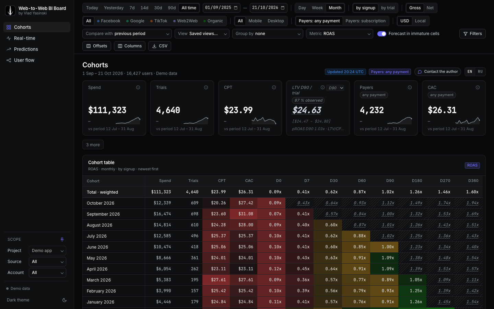
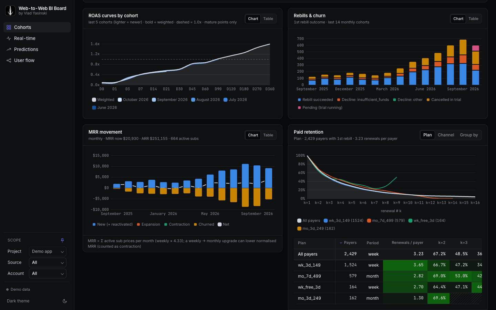
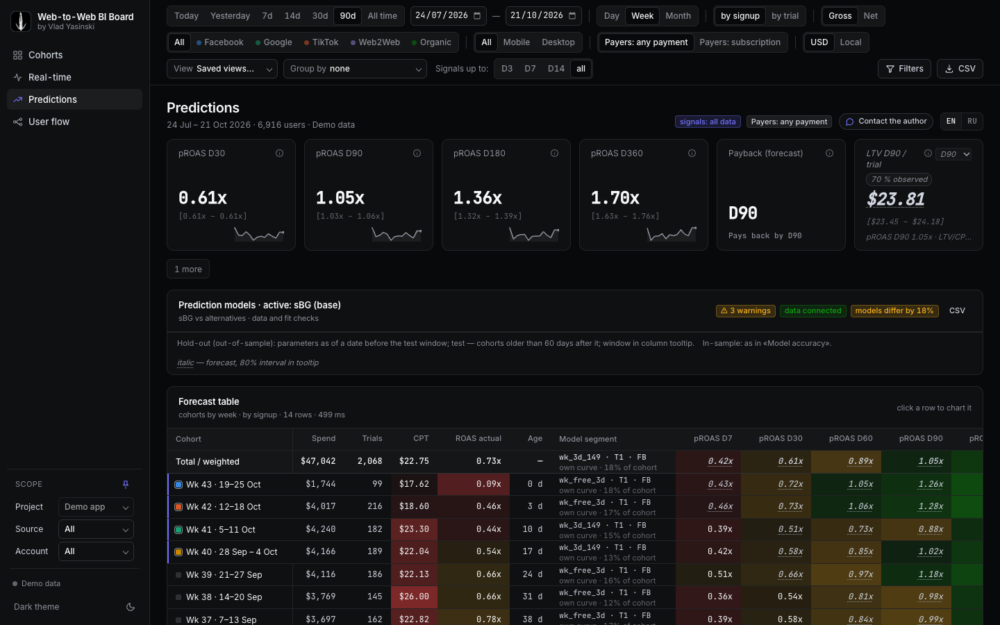
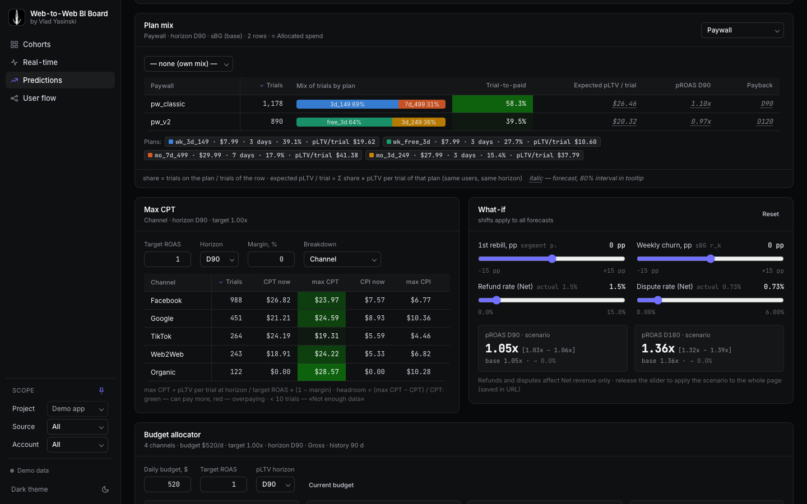
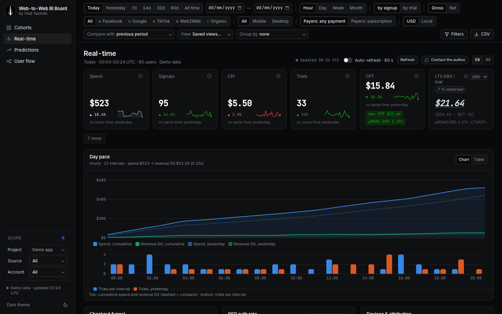
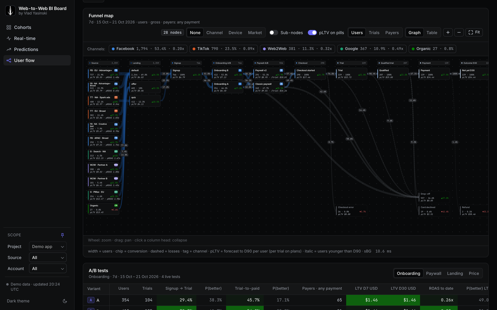
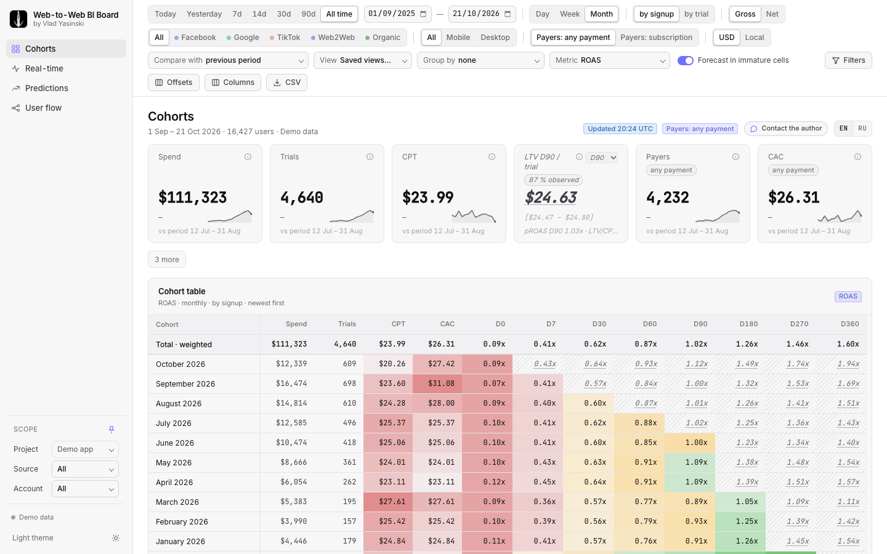
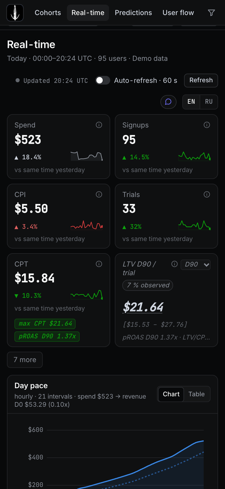

<p align="center">
  <a href="LICENSE"></a>
  <a href="CHANGELOG.md"></a>
  <a href="https://ua5er.github.io/web2web-bi-board/"></a>
  
  <a href="https://alternativeto.net/software/web-to-web-bi-board/about/?utm_source=badge&utm_medium=referral"></a>
</p>

# Web-to-Web BI Board

Web-to-Web BI Board is an open-source BI dashboard for subscription web funnels (web-to-web). It turns your Facebook, Google, TikTok and Web2Web ad spend, signups, trials and payments into cohort analysis with ROAS and LTV from D0 to D360, payback day, sBG predictions, real-time spend monitoring and a funnel map. It is a static site with no backend.

<p align="center">
  <a href="https://ua5er.github.io/web2web-bi-board/"></a>
  <br>
  <sub><a href="https://ua5er.github.io/web2web-bi-board/"><b>Open the live demo</b></a> · <a href="docs/media/demo.mp4">Demo video (MP4)</a> · <a href="docs/DATA_CONTRACT.md">Data contract</a> · <a href="https://www.roimobi.com/tg?src=github-bi-board">Message the author on Telegram</a></sub>
</p>

A subscription business that sells on the web pays for traffic today and gets paid back over weeks and months of renewals. This board answers the questions a growth team asks every day: which cohorts and channels pay back and when, what a trial is worth before the renewals arrive, how much you can afford per trial, whether today's traffic is healthy, and where users are lost between the ad click and the second payment. It ships with a synthetic demo dataset for a fictional "Demo app", and it runs on your own data once you export it to one JSON file.

**Live demo:** https://ua5er.github.io/web2web-bi-board/

## Cohort ROAS and payback dashboard



The **Cohorts** page ([live](https://ua5er.github.io/web2web-bi-board/)) groups users by signup or trial date (day, week or month) and follows each cohort's money:

- **ROAS D0 to D360** with the payback day. Mature cells are actual; immature cells can show the forecast (dashed italic, 80 % interval in the tooltip).
- KPI tiles: spend, trials, CPT, LTV per trial at a chosen horizon, payers, CAC, with deltas against the previous period.
- ROAS curves by cohort, rebills and churn per cohort, **MRR movement** (new, expansion, contraction, churned, net), **paid retention** by renewal number per plan or channel.
- Breakdown matrix by country, channel, campaign, creative, device, paywall, plan and more, with a second level on click.
- Voluntary and involuntary churn with reasons, and **billing health**: declines by dunning attempt, decline codes, card type, refund rate, dispute rate against the 0.75 % threshold.



## LTV and ROAS predictions



The **Predictions** page ([live](https://ua5er.github.io/web2web-bi-board/predict.html)) forecasts what young cohorts will be worth:

- **pROAS and LTV per trial** at D30, D90, D180 and D360 with 80 % intervals, and the forecast payback day.
- **Max CPT calculator**: the highest price per trial (and per install) that still meets a target ROAS at a chosen horizon and margin, per channel or any breakdown.
- **What-if scenarios**: sliders for the first rebill rate, renewal churn, refund and dispute rates; the scenario can be applied to the whole page and is saved in the URL.
- Plan mix by paywall or campaign, a **budget allocator** across channels, an MRR forecast and survival curves by geo or channel.
- **Model comparison and backtest**: the sBG base model next to alternative retention models, with data checks, fit checks and an out-of-sample test.



### How the forecast works

- **Segments.** Every user belongs to a segment: plan × geo tier × channel. A segment with too little history borrows its parameters from the next level up (plan × geo tier, then plan, then all users), and the page shows which level each row uses.
- **Trial to paid.** The share of ended trials whose first rebill succeeded, weighted toward recent trials (45-day half-life by default), plus the chance that a failed first payment is recovered by a retry.
- **Renewals.** The chance of paying renewal *k* after paying *k − 1* follows a shifted-beta-geometric (sBG) curve (Fader and Hardie): churn probability varies across subscribers, so retention improves with tenure. Its two parameters are fitted by maximum likelihood on the observed renewal outcomes. Renewals due in the last 4 days and renewals inside declared incident windows (for example a payment provider outage) are left out as censored.
- **Revenue to day N** = money already received + expected future payments of users still in play: running trials (first rebill probability given they have not cancelled yet), active and past-due subscriptions (survival to each next renewal at the plan's price), plus the average add-on revenue per payer. Net mode subtracts the segment's refund, dispute and fee rates.
- **Interval.** The 80 % band combines the payment-by-payment variance with the sampling error of the fitted rates (normal approximation). It does not cover changes that are not in the data yet, such as a new price, a new creative or seasonality.
- **Alternatives.** Power curve, power curve with decay borrowed from a mature segment, constant churn, log curve, discrete Weibull, Kaplan–Meier with a carried tail, and three sBG variants by the author that blend observed renewals with a benchmark prior (fixed benchmark, parent segment, and recency-weighted trial-to-paid with a plan-mix model). The models panel shows how far each one is from sBG at D90 and D180.
- **Backtest.** In-sample: for weekly cohorts at least 60 days old, predict D30 revenue using only the data available at D3 or D7 and compare with the actual (MAPE and bias). Hold-out: refit the parameters as of a date before the test window, so the tested cohorts were never seen by the fit, and also report how often the actual falls inside the 80 % band.

Forecasts are only as good as the history behind them. With a few hundred renewals per segment they are useful for comparing channels and setting bid caps; with less, the page says so ("Not enough data", fallback levels, data warnings). Nothing in this repository claims a specific accuracy on real data.

## Real-time ad spend monitoring



The **Real-time** page ([live](https://ua5er.github.io/web2web-bi-board/realtime.html)) shows whether today's paid traffic is healthy:

- **Spend pace** against the same time yesterday, CPT, CPI, trials and **ROAS D0** by hour.
- **Checkout funnel** (paywall view, checkout started, trial started) with checkout errors by payment provider and method.
- **Payment provider status**: auth rate in the last hour against the last 24 hours, with an alert when it drops.
- Device and attribution chips (click id coverage, EMQ proxy, in-app webview share).
- Traffic tree by channel, campaign, ad set and ad with status colours, **signals** from editable rules (expensive trials, spend without trials, low qualified rate, CPA over the partner contract), geo by hour and a **live event feed**.

## Funnel map



The **User flow** page ([live](https://ua5er.github.io/web2web-bi-board/flow.html)) draws the whole funnel as a graph: traffic source and landing, signup, onboarding A/B, paywall A/B, checkout, trial, qualified trial, payment, outcome at D30, and the losses on the way (drop-off, checkout error, card declined, refund, dispute). Edge width is users, chips are conversion rates, nodes carry forecast LTV. Lanes split the map by channel, device or market, and the A/B tests card compares variants with the probability that each one is better.

## How to run it

The board is plain HTML, CSS and JavaScript. There is nothing to install or build.

```bash
git clone https://github.com/ua5er/web2web-bi-board.git
cd web2web-bi-board
npx serve .            # or: python3 -m http.server 8000
```

Open the address it prints (for example http://localhost:3000). A static server is needed because browsers block `fetch` on `file://`.

**Publish on GitHub Pages in 3 steps:**

1. Fork or push this repository to your GitHub account.
2. Open **Settings → Pages**, set **Source** to "Deploy from a branch", branch `main`, folder `/ (root)`, and save.
3. Wait a minute and open `https://<your-user>.github.io/web2web-bi-board/`. The repository root is the site: `index.html` is the Cohorts page and `.nojekyll` makes Pages serve every file as is.

To regenerate the demo data (deterministic, same seed gives the same file):

```bash
node tools/generate-demo-data.mjs              # writes data/demo.json and data/status.json
node tools/generate-demo-data.mjs --seed 42    # another synthetic dataset
```

## Bring your own data

Export your data into one JSON file that follows the [data contract](docs/DATA_CONTRACT.md): `users`, `trials`, `charges`, `refunds`, `disputes` and `spend` tables, plus optional `campaigns`, `ads`, `events`, `plans`, `paywalls` and `incidents`. Timestamps may be ISO strings, milliseconds or seconds; big tables may use a compact columnar form.

Then point the board at it:

- add `?data=./data/my-export.json` to any page address, or
- change `data-src="./data/demo.json"` on the `core.js` script tag in the four HTML pages, or
- set `window.BB_DATA_URL` before `core.js` loads.

The loader validates the file. Errors (for example missing required columns) stop the load and are listed on an error card; warnings become data notes. Run `BB.adapters.validate(json)` in the browser console to check a file. Keep private data out of public repositories and public Pages sites.

## Configuration

Branding and contact links live in [`board.config.js`](board.config.js):

```js
window.BOARD_CONFIG = {
  title: 'Web-to-Web BI Board',
  tagline: 'Web-to-Web BI Board System: cohort payback, predictions, real-time and funnel for subscription web funnels',
  version: '1.0.0',
  stage: 'MVP',
  author: 'Vlad Yasinski',
  github: 'ua5er',
  telegram: 'ua5er',                      // visible handle
  telegramUrl: 'https://www.roimobi.com/tg?src=bi-board-demo', // where the Telegram links go; empty = https://t.me/<telegram>
  linkedin: 'https://www.linkedin.com/in/vlad-yasinski-ua5er/',
  site: 'https://www.roimobi.com',
  siteUrl: 'https://www.roimobi.com/?utm_source=bi-board-demo&utm_medium=demo&utm_campaign=web2web-bi-board', // empty = `site`
};
```

- **Logo and favicon** are loaded live from `https://github.com/<github>.png?size=128`, so they change when the GitHub avatar changes. If the avatar cannot be loaded, the initials of `author` are shown instead.
- The **Contact the author** button and the footer on every page use `telegram`, `linkedin`, `github` and `site`. `telegramUrl` and `siteUrl` set where the Telegram and website links point (the visible text stays `t.me/<telegram>` and the site host). Set both to empty strings to link straight to `t.me/<telegram>` and `site`.
- The plan catalogue, channels, metrics and dimensions are defined in `core.js`; a data file can bring its own plan catalogue.
- Language: English by default, Russian with the EN / RU switch (`i18n/ru.js`). Theme: dark or light, remembered per browser.

## How it is built

- **Static and serverless.** Four HTML pages share a data layer (`core.js`: loader, validation, aggregation, predictions, URL state) and a UI kit (`ui.js`: shell, toolbar, tables, charts, funnel graph). Page scripts: `cohorts.js`, `predict.js`, `realtime.js`, `flow.js`.
- **No build step, no framework.** Vanilla JavaScript; [Chart.js 4](https://www.chartjs.org/) from a CDN for charts; Inter and JetBrains Mono from Google Fonts.
- **All computation happens in the browser** from the loaded JSON. Every view (range, step, filters, model, scenario) is stored in the URL hash, so a link reproduces the view.
- **Responsive and themed.** Dark and light themes, layouts down to a 390 px phone.
- **Reproducible media.** Screenshots, the demo GIF and MP4 and the social preview come from `tools/capture_media.py` (Python Playwright and ffmpeg, optional dev tools).

<p>
  
  
</p>

## Roadmap

Planned, not included in v1.0.0:

- Data connectors that build the JSON file automatically: Meta Marketing API, Google Ads, TikTok Ads, Stripe, Amplitude.
- Scheduled refresh (for example a GitHub Action that rebuilds the data file).
- Offline model files (Cox / random survival forest, ARIMA on MRR) through the existing offline-model hook in `core.js`.
- More languages for the UI.

Want one of these first, or the board running on your data? [Message me on Telegram](https://www.roimobi.com/tg?src=github-bi-board).

## FAQ

**What is a web-to-web (web2web) funnel?**
A subscription funnel that stays on the web: an ad leads to a landing page or quiz, then a web paywall and a web checkout (card, Apple Pay, Google Pay, PayPal), and the subscription renews on the web. There is no app store purchase, so the business sees every step and every payment itself, and has to measure payback itself.

**Which data does the board need?**
At minimum: users (signups with time, country and channel), trials, payment attempts (charges with type, renewal number and status), refunds, disputes and ad spend by date and ad. Product events, campaign and ad lookups, the plan catalogue and incident windows are optional. See [docs/DATA_CONTRACT.md](docs/DATA_CONTRACT.md).

**How does the sBG forecast work, and what are its limits?**
It estimates the trial-to-paid rate per segment and fits a shifted-beta-geometric curve to observed renewals, then adds the expected future payments of users still in play to the revenue already received, with an 80 % interval. It needs renewal history: thin segments fall back to broader ones, and it cannot foresee changes that are not in the data yet (new prices, new creatives, seasonality). Check the backtest panel before trusting it.

**Is it free?**
Yes. The code is open source under the MIT license, including commercial use.

**Does it need a backend or a database?**
No. It is a static site: any static host (GitHub Pages, Netlify, S3, a local `npx serve`) serves it, and all calculations run in the browser from one JSON file.

**Can it pull data from Meta, Google Ads, TikTok or Stripe directly?**
Not in v1.0.0. You export the data into the JSON format; connectors are on the roadmap.

**Is the demo data real?**
No. `data/demo.json` is synthetic, produced by `tools/generate-demo-data.mjs` for a fictional "Demo app". Every product, campaign, partner, user and payment in it is invented.

**How do I get this board on my own data?**
Export your data to the contract yourself, or [message me on Telegram](https://www.roimobi.com/tg?src=github-bi-board) and I will help set it up on your data.

## Privacy

The hosted demo at ua5er.github.io counts anonymous page views and contact clicks with PostHog (EU), without cookies or personal data. It honours Do Not Track and Global Privacy Control. Copies you host yourself send nothing.

## Author

**Vlad Yasinski**, AI growth consultant for subscription apps ([roimobi.com](https://www.roimobi.com/?utm_source=github&utm_medium=readme&utm_campaign=web2web-bi-board)).

- Telegram: [t.me/ua5er](https://www.roimobi.com/tg?src=github-bi-board)
- LinkedIn: [linkedin.com/in/vlad-yasinski-ua5er](https://www.linkedin.com/in/vlad-yasinski-ua5er/)
- GitHub: [github.com/ua5er](https://github.com/ua5er)
- Site: [www.roimobi.com](https://www.roimobi.com/?utm_source=github&utm_medium=readme&utm_campaign=web2web-bi-board)

Built by Vlad Yasinski. Want this board on your data? [Message me on Telegram](https://www.roimobi.com/tg?src=github-bi-board).

## License

[MIT](LICENSE) © 2026 Vlad Yasinski. Icons in the UI follow the shapes of [Feather](https://feathericons.com/) (MIT). If you use the board in research or a write-up, GitHub's "Cite this repository" uses [CITATION.cff](CITATION.cff).
